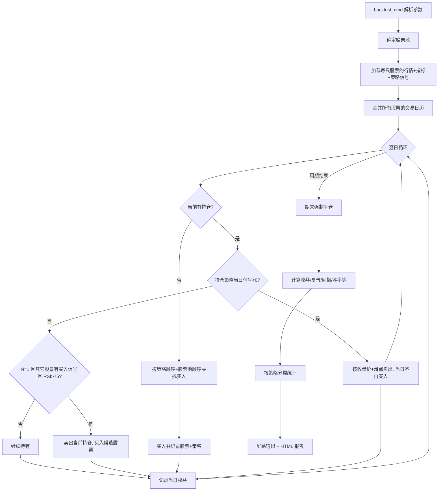

# `--onestock` 单持仓轮动回测设计

本文说明 `backtest --onestock` 的代码处理流程、信号语义、资金与持仓规则、指标口径和输出结构。

核心实现：`main.py:4397` `_run_onestock_backtest()`  
命令入口：`main.py:4678` `backtest_cmd()`  
策略统计：`main.py:4336` `_build_onestock_breakdown()`

---

## 1. 功能定位

`--onestock` 是“单持仓轮动”回测模式：

- 任意时刻最多持有一只股票；
- 空仓时按策略优先级和股票池顺序寻找买入信号；
- 买入后记录触发买入的策略；
- 只有“同一股票 + 同一策略”出现卖出信号时才清仓；
- 清仓后可再次从股票池中寻找新的买入机会；
- 期末仍有持仓时按最后一个交易日收盘价强制平仓。

它不同于普通批量回测：普通回测对每只股票独立运行策略，`--onestock` 在股票之间共享同一笔资金。

---

## 2. 命令与选项

示例：

```bash
python3 main.py backtest \
    -sf input/pool.txt \
    -st 20200101 -e 20251231 \
    -g boll,macd \
    --onestock
```

### 2.1 `--onestock [N]`

```python
@click.option('--onestock', type=click.IntRange(0, 1),
              default=None, is_flag=False, flag_value=0)
```

| 写法 | 行为 |
|------|------|
| 不指定 | 普通回测，不进入单持仓模式 |
| `--onestock` | 等价于 `N=0` |
| `--onestock 0` | 持仓期间忽略其它股票的买入信号 |
| `--onestock 1` | 持仓期间若其它股票出现买入信号，且当前持仓 RSI14 > 75，则换股 |

### 2.2 相关选项

| 选项 | 作用 |
|------|------|
| `-s` / `-sf` | 指定股票池；未指定时默认读取 `input/pool.txt` |
| `--random` | 忽略 `-s/-sf`，按板块比例随机抽取 100 只，空仓时刷新股票池 |
| `-g` | 策略列表，顺序即买入优先级；`hold` 会被排除 |
| `-c` | 初始资金（万元） |
| `--fixcapital` | 每次买入固定使用初始资金额度 |
| `--maxholddays N` | 信号层最大持股限制 |
| `--nodownbuy` / `--block-buy-on-downtrend` | 大盘趋势为“下跌”或“过热”时禁止买入；同时适用于 analyze/scan/backtest/compare |
| `--downlosssell` | 下跌且持仓亏损>2%或单日跌幅>5%时卖出；上涨优先 MACD 买入信号，震荡/过冷优先 BOLL 买入信号 |
| `--verbose` | `--onestock` 时在 HTML 报告中增加“指数K线 + 权益曲线 + 买卖三角”单图 |
| `--seqnum/-sn` | BOLL 买入序号过滤 |
| `--src` | 数据源选择 |

注意：

- `--onestock` 会直接返回，不进入普通批量回测/单股回溯路径；
- `--chart` 在 `--onestock` 下不生效；`--verbose` 会生成指数K线/权益曲线单图并嵌入 HTML；
- 股票池为空、无有效数据、或策略中只有 `hold` 时直接报错返回；
- 大盘趋势为“过热”时始终禁止买入；开启 `--nodownbuy` 后“下跌”日也禁止买入；
- 大盘趋势为“过冷”时忽略最大回撤、最大持股天数和亏损止损等强制卖出，常规策略卖出仍执行；
- `--nodownbuy` 在 analyze / scan / backtest / compare 中均作用于策略原始买入信号。

---

## 3. 总体流程



---

## 4. 股票池与数据加载

### 4.1 股票池来源

`backtest_cmd` 在进入 `_run_onestock_backtest` 前确定 `symbols`：

1. `--random`：从全市场按板块比例随机抽取 100 只，忽略 `-s/-sf`；
2. `-s` 与 `-sf`：合并、去重；
3. 都未指定：默认读取 `input/pool.txt`。

`_file_part` 用于报告文件名：

- `--random` → `random`
- `-sf` → 文件名（不含路径/扩展名）
- 仅 `-s` → 股票代码拼接

### 4.2 单只股票加载

`load_one(sym)`：

1. `DataFetcher.get_stock_data(sym, start-90天, end)`；
2. `add_all_indicators(df)`；
3. `_truncate_analysis_df(df, start_date)`，去掉预热期；
4. 对每个策略生成最终信号；
5. 返回 `(df, sigs)` 并缓存在 `loaded` 字典中。

加载失败或数据为空的股票会被静默跳过。股票池 >= 20 只时，每加载 10 只打印一次进度。

### 4.3 策略信号

```python
source_keys = [k for k in strat_keys if _strat_base(k) != 'hold']
```

- `hold` 仅作为普通回测的基准策略，在 `--onestock` 中被排除；
- 策略实例使用通用 `STRATEGY_MAP`，不使用 analyze 中的 ETF/指数专属参数；
- `strat_enhance` 当前固定为 0，增强参数已废弃；
- 信号由 `_generate_effective_signals()` 生成，包含：
  - 策略自身买卖条件；
  - 当日涨幅 ≥ 9.9% 取消买入；
  - `SAR_CHECK` 买入过滤；
  - `INDEX_CHECK` 买入过滤；
  - BOLL 的 `--seqnum` 过滤；
  - `--maxholddays` 最大持股过滤。

### 4.4 `--maxholddays` 条件

当前卖出条件：

```text
持股时间 > N 个交易日
且 收盘价 < BOLL 中线
且 持仓期最大回撤 > 10%
```

- 建仓后首次买入开始计时；
- 持仓期间重复买入不重置计时；
- 最大回撤按持仓期内最高收盘价到当前收盘价计算；
- 卖出后重置建仓计时和峰值；
- 屏幕不打印交易明细，但 HTML 报告仍保留。

---

## 5. 交易日历

```python
calendar = sorted(set().union(*[set(df.index) for df, _ in loaded.values()]))
```

- 取所有成功加载股票的日期并集；
- 循环按该联合日历推进；
- 某只股票当天没有行情时：
  - 不产生该股票的买卖；
  - 估值时用 `close.asof(d)` 取最近有效收盘价。

因此，停牌期间卖出信号会延后到有行情的交易日。

---

## 6. 持仓状态与交易执行

### 6.1 持仓结构

```python
hold = {
    'symbol': 股票代码,
    'sk': 触发买入的策略 key,
    'shares': 持股数,
    'cost': 买入成本（含佣金前的资金额度）,
    'entry_date': 买入日期,
    'entry_price': 买入执行价,
}
```

### 6.2 买入

`_buy(sym, sk, df, d)`：

```text
执行价 = 当日收盘价 × (1 + 滑点)
买入资金 = 初始资金（--fixcapital）或当前现金
持股数 = 买入资金 / (执行价 × (1 + 佣金))
现金 -= 买入资金
```

固定佣金/滑点：

```text
commission = 0.0003
slippage   = 0.0001
```

注意：`--fixcapital` 每次按初始资金额度买入，若此前亏损导致现金不足，现金会变为负数（等价于固定名义本金、不做现金约束）。

### 6.3 卖出

`_sell(d, reason)`：

```text
执行价 = 当日收盘价 × (1 - 滑点)
卖出收入 = 持股数 × 执行价 × (1 - 佣金)
现金 += 卖出收入
```

交易记录包含：

```text
entry_date, exit_date, symbol, strategy,
entry_price, exit_price, position,
return, holding_days, exit_reason
```

`exit_reason`：

| 值 | 含义 |
|----|------|
| `signal` | 持仓策略发出卖出信号 |
| `replace` | `--onestock 1` 换股 |
| `downloss` | 大盘下跌且持仓亏损>2%或单日跌幅>5%止损 |
| `end` | 期末强制平仓 |

### 6.4 卖出优先级

每日循环顺序：

1. 若持仓，且持仓策略当日信号 `< 0`：卖出，`continue`，**当日不再买入**；
   （“过冷”时仅由最大回撤/最大持股天数触发的卖出已被抑制）
2. 若开启 `--downlosssell`，大盘趋势为“下跌”，且当前价相对建仓价亏损超过 2% 或当日较前一交易日下跌超过 5%：卖出，**当日不再买入**；
3. 若空仓且需要刷新随机池：刷新；
4. 若空仓：寻找买入；
5. 若持仓且 `N=1`：尝试换股；
6. 记录当日权益。

### 6.5 买入选择顺序

默认 `_pick_buy(d)` 按：

```text
策略顺序（-g 的先后）
    → 股票池顺序
    → 当日该策略信号 > 0 的第一只
```

因此 `-g boll,macd` 默认表示 BOLL 优先于 MACD。

开启 `--downlosssell` 后，策略顺序会随当日大盘趋势调整：

| 大盘趋势 | 优先策略 | 后续策略 |
|----------|----------|----------|
| `上涨` | MACD | 其余策略按 `-g` 顺序 |
| `震荡` / `过冷` | BOLL | 其余策略按 `-g` 顺序 |
| `下跌` / `过渡` / `过热` | 不调整 | 按 `-g` 顺序 |

优先策略未包含在 `-g` 中或当日无买入信号时，自动回退到其余策略。

### 6.6 换股模式 `--onestock 1`

持仓期间，如果：

- 其它股票出现买入信号；
- 当前持仓 RSI14 > 75；
- 候选股票不是当前持仓；

则：

```text
卖出当前持仓（reason=replace）
→ 立即买入候选股票
```

不满足 RSI 条件时继续持有。

---

## 7. 权益曲线

每个交易日记录：

```text
equity = 现金 + 持仓市值
持仓市值 = 持股数 × 当日收盘价（缺失时用最近有效价）
```

期末仍有持仓时：

```text
按最后一个联合交易日收盘价强制卖出
equity[-1] = 清仓后现金
```

---

## 8. 指标计算

### 8.1 总体指标

`_calc_sharpe_drawdown(equity)`：

- 日收益率 = 权益曲线 `pct_change()`；
- 夏普比率：扣除年化无风险利率 3% 后计算；
- 最大回撤：权益曲线历史峰值到当前值的最大跌幅。

其他指标：

```text
总收益率 = (期末权益 - 初始资金) / 初始资金
年化收益率 = 总收益率 × 250 / 累计持股天数
胜率 = 盈利交易数 / 总交易数
盈利因子 = 总盈利 / |总亏损|
```

注意：这里的“年化收益率”是按累计持股天数折算，不是按回测自然日/年数折算。

### 8.2 按策略分类

`_build_onestock_breakdown()`：

- 按交易的 `strategy` 字段分组；
- 每组的“总收益率”是该组交易收益的复利累计；
- 每组的“年化收益率” = 组累计收益率 × 250 / 组累计持股天数；
- “最大回撤/夏普比率”只对“全部”列有效，策略列显示 `—`；
- 输出列：

```text
指标 | 全部 | 策略1 | 策略2 | ...
```

指标行：

```text
总收益率、年化收益率、最大回撤、夏普比率、交易次数、
胜率、平均收益率、盈利因子、平均持仓天数、
总盈亏额、最大单笔盈利、最大单笔亏损
```

---

## 9. 屏幕与 HTML 输出

### 9.1 屏幕

```text
单持仓轮动回测
策略: BOLL, MACD
初始资金: ...
正在加载股票池（N 只）...
回测结果（按策略分类）
[表格]
# 屏幕不打印交易明细（HTML 报告仍保留）
HTML报告已保存到: ...
回测完成!
```

### 9.2 HTML 报告

文件名：

```text
report/backtest_<file_part>_<start>_<end>_<strategy>_<mmddHHMM>_onestock.html
```

报告包含：

- 标的：`单持仓轮动(N只)`；
- 回测区间、初始资金、数据来源、生成时间；
- 阈值备注（最大回撤、RSI、PE、seqnum）；
- 命令选项、软件版本；
- “回测结果（按策略分类）”表；
- “交易明细”表（屏幕始终不打印，HTML 保留）；
- 开启 `--verbose` 时增加“指数K线与权益曲线”单图：指数K线、权益曲线（次坐标轴）和买入红三角/卖出绿三角叠加在同一张图，不使用子图；指数K线位于下方、权益曲线位于上方，两者分区显示尽量减少交叉；权益曲线起点位于图表高度约 2/3 处；权益轴上下限根据权益数据自动设置，刻度按万元显示（如 200 表示 200 万，不带“万”后缀）；股票代码标注在买入三角下方。

### 9.3 返回值

`_run_onestock_backtest()` 现在返回：

```python
{
    'result': result,
    'trades': trades,
    'equity': equity,
    'html_path': html_path,
    'chart_path': chart_path,
    'breakdown_headers': breakdown_headers,
    'breakdown_rows': breakdown_rows,
}
```

CLI 调用方忽略返回值；测试脚本可直接使用交易记录和统计结果。

---

## 10. 随机池模式

`--random` 时：

- 初始股票池由 `_random_pick_by_board()` 按：

```text
沪市主板 : 深市主板 : 创业板 : 科创板 = 6 : 5 : 5 : 2
```

随机抽取 100 只；

- `random_mode=True`；
- 每次“信号卖出后进入空仓”的下一轮循环，会重新抽取 100 只并重新加载；
- 换股（`replace`）不会触发刷新；
- 随机池刷新使用 `_sample_random_pool(random_count)`，默认 `random_count=100`。

---

## 11. 关键约束与注意事项

1. **单一持仓**：不会同时持有两只股票，也不做分批建仓/减仓。
2. **全仓买入**：默认使用全部现金；`--fixcapital` 使用固定初始资金额度。
3. **收盘价成交**：买入/卖出均按信号日收盘价加/减滑点，不按次日开盘价。
4. **无印花税**：当前仅模拟佣金和滑点。
5. **持仓天数按联合交易日历统计**：停牌或数据缺口可能使持仓天数偏大。
6. **换股不刷新随机池**：随机模式下只有信号卖出后才刷新。
7. **策略映射为通用策略**：不复用 analyze 的 ETF/指数专属参数。
8. **`--chart` 不生效；`--verbose` 生效**：`--onestock` 不进入普通批量图表流程，但 `--verbose` 会额外生成指数K线与权益曲线单图并嵌入 HTML。
9. **`--maxholddays` 只影响信号**：不改变 onestock 的资金和持仓规则；大盘“过冷”时该强制卖出被抑制。
10. **报告文件名包含 `_onestock.html`**：避免与普通回测报告混淆。

---

## 12. 代码索引

| 功能 | 位置 |
|------|------|
| 命令入口 | `main.py:4678` `backtest_cmd()` |
| onestock 分支 | `main.py:4764` |
| 主回测函数 | `main.py:4397` `_run_onestock_backtest()` |
| 策略统计 | `main.py:4336` `_build_onestock_breakdown()` |
| 随机池抽样 | `main.py:3772` `_random_pick_by_board()` |
| 随机池刷新 | `main.py:4321` `_sample_random_pool()` |
| 信号生成 | `main.py:378` `_generate_effective_signals()` |
| 最大持股过滤 | `main.py:308` `_apply_max_hold_days()` |
| 夏普/回撤 | `main.py:708` `_calc_sharpe_drawdown()` |
| HTML 报告 | `main.py:1463` `_generate_backtest_html()` |
